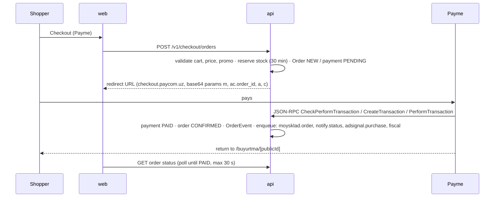

# 03 · Architecture

## Decisions (ADR summary)
| # | Decision | Why | Rejected |
|---|---|---|---|
| 1 | **Monorepo** pnpm + Turborepo | Shared types/DB client/UI tokens across web, admin, api | Polyrepo (sync overhead) |
| 2 | **Next.js 15 (App Router, RSC)** for storefront `apps/web` | SSR/SSG for SEO, image optimization, i18n routing | SPA (bad SEO) |
| 3 | Separate **Next.js admin** `apps/admin` on `admin.forest.uz` | Isolation (security, bundle size), different auth | Admin inside web app |
| 4 | **NestJS** API `apps/api` (REST + webhooks + jobs + bot) | Modular, DI, guards for RBAC, matches owner's stack | Next.js route handlers only (business logic sprawl) |
| 5 | **PostgreSQL 16** + **Prisma** | Relational orders/CRM, JSONB for localized fields & event props, mature migrations | Mongo |
| 6 | **Redis 7 + BullMQ** | Queues: webhooks fan-out, MoySklad sync, notifications, audience sync, heatmap aggregation; rate limiting; OTP | Cron-only |
| 7 | **S3-compatible object storage** (MinIO self-hosted, or a UZ provider) | Product images, review photos, session-replay chunks, exports | Local disk |
| 8 | **First-party analytics** in Postgres (`events` partitioned monthly) + **rrweb** replays in object storage | Owner wants no GA/Metrika dependency; data stays in UZ | PostHog self-host (heavy: ClickHouse+Kafka), GA4 |
| 9 | **Adapter pattern for every integration** (`PaymentProvider`, `DeliveryProvider`, `SmsProvider`, `InventoryProvider`, `AdSignalProvider`, `FiscalProvider`) with `fake` implementations | Build & test everything without credentials; swap providers from admin | Direct SDK calls in services |
| 10 | **Integration credentials in DB, encrypted** (AES-256-GCM, key from env `APP_ENCRYPTION_KEY`) editable only by Owner in admin | Owner connects services from admin (A10) without deploy | `.env` only |
| 11 | Docker Compose for dev & single-server prod; Caddy reverse proxy (auto TLS) | Simple ops for MVP | Kubernetes (overkill) |
| 12 | Hosting: VPS **in Uzbekistan** for DB + API (personal data law), Cloudflare in front of static/images | Compliance + speed | Foreign-only cloud |
| 13 | Validation: **zod** shared schemas (`packages/contracts`) used by web forms, admin and API DTOs | One source of truth for request/response types | class-validator only |
| 14 | Styling: **Tailwind CSS v4** with tokens from `packages/ui/tokens` + Radix primitives / shadcn-style components | Fast, consistent, accessible | CSS-in-JS |
| 15 | i18n: **next-intl** (locale prefix routing) | App Router support, ICU messages | – |

If Claude Code wants to deviate from any decision, it must write the reason in `CLAUDE.md → Decisions` first.

## Repository layout
```
forest/
├─ apps/
│  ├─ web/            # Next.js storefront (uz/ru), port 3000
│  ├─ admin/          # Next.js admin panel, port 3001
│  └─ api/            # NestJS: REST /v1, webhooks, jobs, telegram bot, port 4000
├─ packages/
│  ├─ db/             # Prisma schema, migrations, seed, client export
│  ├─ contracts/      # zod schemas + TS types shared by apps (DTOs, events, enums)
│  ├─ ui/             # design tokens, Tailwind preset, shared React components
│  ├─ tracker/        # tiny first-party analytics + rrweb loader script (<6 KB gz core)
│  └─ config/         # eslint, tsconfig, prettier presets
├─ infra/
│  ├─ docker/         # Dockerfiles
│  ├─ compose.yml     # postgres, redis, minio, api, web, admin, caddy
│  └─ Caddyfile
├─ design/            # this handoff's design folder (read-only reference)
├─ docs/              # this handoff's docs (keep updated)
├─ CLAUDE.md
└─ .env.example
```

## API module map (NestJS)
```
auth          customer OTP (SMS), Telegram login, admin auth (password + TOTP), sessions
catalog       categories, products, variants, bundles, search (pg_trgm + unaccent + synonyms)
cart          carts, cart merge, pricing engine (promo, shipping, bundle rules)
checkout      quote, create order, reservation
orders        lifecycle state machine, events, SLA timers, refunds
payments      providers: payme, click, cod  (webhook controllers)
fiscal        receipt building (IKPU), provider adapter
delivery      zones, quotes, providers: yandex, bts (+ webhooks/polling), tracking tokens
inventory     moysklad sync (webhooks + scheduled), reservations
customers     CRM, consents, tags, merge, GDPR-like export/delete
reviews       verified reviews, moderation, gallery
promo         codes, automatic promotions, fraud flags
analytics     ingest endpoint, sessions, attribution, reports, heatmap aggregation, replay storage
audiences     segment rules → materialized members → sync to ad platforms
adsignals     Meta CAPI, Google Ads conversions, TikTok Events, Yandex Metrika offline conversions
seo           meta per page/locale, redirects, 404 log, sitemap, robots, IndexNow, GSC/YWM APIs
content       pages (legal, Ilhom articles), FAQ, home blocks, bestsellers
notifications templates (uz/ru), channels: telegram, sms; caps; opt-out
bot           Telegram webhook, flows (lead, status, cart, advice, review), operator inbox
integrations  registry, encrypted credentials, health checks, webhook endpoints & logs
settings      store, delivery zones & rules, staff, roles, audit log
files         uploads (images, review photos), signed URLs, image variants
```

## Key flows

### Online payment (Payme)


### COD
Order NEW (payment `COD_PENDING`) → operator calls within 15 min → `CONFIRMED` → same pipeline. Courier settles → payment `PAID` + fiscal receipt via OFD provider.

### MoySklad sync
- Webhooks from MoySklad (product, variant, stock, price changes) → queue → upsert.
- Hourly full reconciliation job (paginated) as safety net.
- Order created/paid/cancelled → push `customerorder` with reservation; customer → `counterparty`.
- All sync results → `IntegrationLog` (visible in A13).

### Analytics ingest
`packages/tracker` → `POST /v1/t` (batched, `sendBeacon`) → validate → enrich (UA parse, GeoIP city, bot filter, UTM/click ids) → insert into `events` → update `sessions`. Server-side events (order paid, refund, bot actions) inserted by the API itself with same schema. Details: `07-analytics-tracking.md`.

## Environments
- `local` (docker compose, fake providers), `staging` (sandbox credentials: Payme test, Click test), `production`.
- Feature flags in `settings.flags` (e.g. `marketplace`, `cod`, `bnpl`).

## Observability
- Structured JSON logs (pino) with request id; Sentry (or GlitchTip self-hosted) for web/admin/api errors.
- Health endpoints `/health`, `/ready`; uptime monitor; queue dashboard (Bull Board) behind admin auth.
- Alerts to admin Telegram group: failed webhooks, payment errors, SLA breach risk, sync errors, low stock.
